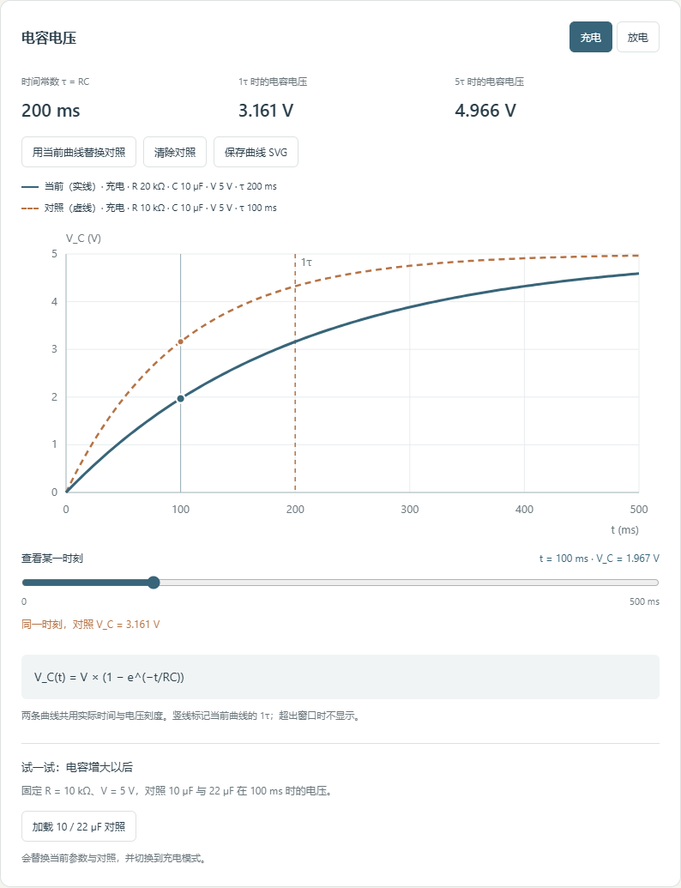

# RC Step View · RC 充放电

一个看理想 RC 充放电曲线的小页面。改电阻、电容和电压，观察时间常数与电容电压的变化。没有依赖，浏览器打开就能用。

A small page for exploring ideal RC charging and discharging. Change the resistance, capacitance and voltage to inspect the time constant and capacitor voltage. No dependencies are needed.


## 使用 / Use

下载仓库，用浏览器打开 `index.html`。参数会在输入有效数字后更新，也可以点击“更新曲线”。切换“充电 / 放电”，拖动下方滑块查看某一时刻的电压。

Download the repository and open `index.html` in a browser. Valid input updates the curve; you can also click “更新曲线”. Switch between charging and discharging, then move the slider to inspect a point in time.

电阻用 kΩ，电容用 µF，观察时长用 ms。默认 10 kΩ、10 µF、5 V，观察 500 ms。改变 R 或 C 后，时间窗口保持原值，方便在相同时间范围内比较。“显示到 5τ”会按当前参数调整窗口。

Resistance is in kΩ, capacitance in µF and the observation window in ms. Defaults are 10 kΩ, 10 µF, 5 V and 500 ms. Changing R or C keeps the time window fixed for comparison. “显示到 5τ” fits the window to five time constants.

也可以在仓库目录运行 `python -m http.server 8000`，再打开 `http://localhost:8000`。 / You can also run `python -m http.server 8000` in the repository and visit `http://localhost:8000`.

## 留一条曲线作对照 / Keep a comparison curve

点击“保留当前曲线作对照”，再改变 R 或 C。实线是当前参数，虚线是保留的参数，图例列出各自的 R、C、V、模式和 τ。滑块同时读取两条曲线在同一时刻的电压。

Click “保留当前曲线作对照”, then change R or C. The solid line uses current parameters; the dashed line keeps the captured parameters. The legend lists R, C, V, mode and τ for each. The slider reads both voltages at the same time.

每次只保留一条对照，可以替换或清除。对照的电压与模式也会保留，两条曲线共用当前观察窗口，纵轴按较大的电压缩放。“显示到 5τ”仍按当前曲线调整窗口。刷新后对照会清除。

Only one comparison is kept; replace or clear it as needed. Its voltage and mode stay captured. Both curves share the live observation window, with the vertical scale covering the larger voltage. “显示到 5τ” still follows the current curve. Refreshing clears the comparison.



## 保存曲线 / Save a graph

点击“保存曲线 SVG”，下载当前曲线图。文件带有坐标轴、颜色与线型、R/C/V、时间常数、模式、观察时长和当前滑块时刻的电压；有对照时会同时保存两组信息。可单独用浏览器打开，不需要原页面的样式文件。输入无效时会先提示修正，不下载文件。

Click “保存曲线 SVG” to download the current graph. The file includes axes, colors and line styles, R/C/V, time constants, modes, the observation window and voltages at the selected cursor time. Both sets are included when a reference is present. Open the file directly in a browser without the original page or stylesheet. Invalid inputs must be corrected before downloading.

[查看导出的 10 / 22 µF 对照图 / Open the exported 10 / 22 µF comparison](docs/export-example.svg)。这是下面例子的理想模型计算图，并非测量数据。SVG 是图片快照，目前不能导入它来恢复页面参数。

This is a calculated image of the ideal example below, not measured data. The SVG is an image snapshot; it cannot be imported to restore the page parameters.

## 一个电容对照例子 / A capacitance example

点击页面底部的“加载 10 / 22 µF 对照”。这会用下面的两组充电参数替换当前参数和对照，窗口设为 500 ms，滑块放在 100 ms。

Click “加载 10 / 22 µF 对照” below the chart. This replaces the current circuit and reference with the two charging cases below, sets a 500 ms window, and moves the cursor to 100 ms.

| 参数 / Parameter | 对照 / Reference | 当前 / Current |
| --- | --- | --- |
| R | 10 kΩ | 10 kΩ |
| C | 10 µF | 22 µF |
| V | 5 V | 5 V |
| τ | 100 ms | 220 ms |
| V_C at 100 ms | ≈ 3.161 V | ≈ 1.826 V |

同一时刻，较大的电容充电更慢。这里比较的是相同的实际时间；如果各看各的 1τ，两者都会达到约 3.161 V。表中数值由本项目的理想模型计算，页面按四位有效数字显示。

At the same actual time, the larger capacitor charges more slowly. At each circuit's own 1τ, however, both reach about 3.161 V. Table values are calculated by this project's ideal model; the page shows four significant figures.

接着把当前 C 改为 47 µF，先猜 100 ms 的电压，再查看读数。想改代码，可以把例子里的 22 µF 换成 47 µF，同时更新按钮、讲解和表中的计算结果。

Next, change the current C to 47 µF and predict its voltage at 100 ms before checking the reading. For a code exercise, replace 22 µF with 47 µF in the example, then update the button, explanation and calculated table values together.

## 计算方式 / Model

时间常数 `τ = R × C`，计算前把单位换成 Ω 和 F。充电从 0 V 开始，接入所选电压 V 的理想电源；放电从所选电压 V 开始，电源断开，通过 R 放电。

The time constant is `τ = R × C`, after converting to Ω and F. Charging starts at 0 V with the selected ideal supply voltage V. Discharging starts at V with the supply removed and the capacitor connected through R.

```text
Charging:    V_C(t) = V × (1 − exp(−t / τ))
Discharging: V_C(t) = V × exp(−t / τ)
```

页面标出 1τ，并显示 1τ、5τ 的电压。公式依据 [OpenStax University Physics Volume 2, 10.5 RC Circuits](https://openstax.org/books/university-physics-volume-2/pages/10-5-rc-circuits)。曲线是公式计算结果，不是实验测量。

The page marks 1τ and reports the voltages at 1τ and 5τ. The equations follow [OpenStax University Physics Volume 2, 10.5 RC Circuits](https://openstax.org/books/university-physics-volume-2/pages/10-5-rc-circuits). Curves are calculated, not measured.

## 代码与检查 / Code and checks

`model.js` 做单位转换、参数校验和曲线采样；`app.js` 读取输入、画 SVG 图表和电路示意图。观察窗口远大于 τ 时，大部分采样点放在前 10τ，以免漏掉起点附近的快速变化。

`model.js` handles unit conversion, validation and curve sampling. `app.js` reads inputs and draws the SVG chart and circuit sketch. When the window is much longer than τ, most samples cover the first 10τ to retain the fast initial change.

保留对照时复制当前有效模型与模式，之后的输入不会改动这份副本。绘图与读数使用同一套采样和电压函数。 / Capturing copies the valid model and mode, so later input leaves that copy unchanged. Both curves and readings use the same sampling and voltage functions.

`plotImage()` 复制已绘制的 SVG，把实际生效的填色、描边和字体写入元素属性，再补上参数与读数。导出图因此不依赖外部 CSS，显示内容与当前曲线保持一致。 / `plotImage()` clones the drawn SVG, copies the effective fill, stroke and font styles into element attributes, and adds parameters and readings. The exported graph is independent of external CSS and matches the current curves.

装有 Node.js 时运行 `node --test`。检查包括已知参数的数值、固定时刻的 R/C 对比、曲线边界与单调性、长窗口采样和无效输入。 / With Node.js installed, run `node --test`. Checks cover known values, R/C changes at a fixed time, bounds and monotonicity, long-window sampling and invalid input.

一个小练习：先保留默认曲线作对照，保持 500 ms 窗口和滑块的 100 ms 时刻，把 R 从 10 改为 20 kΩ。先猜电压会升高还是降低，再检查两条曲线的 τ 和读数，保存 SVG 并核对两组参数。想改代码，可以试着把默认 C 从 10 改为 22 µF，并让输入框与初始曲线保持一致。

A small exercise: capture the default curve, keep the 500 ms window and the slider at 100 ms, then change R from 10 to 20 kΩ. Predict whether the voltage increases or decreases, then check both time constants and readings. Save an SVG and verify both parameter sets. For a code change, try setting the default C to 22 µF while keeping the input and initial curve consistent.

## 当前限制 / Limits

只处理一个理想电阻和一个理想电容的瞬时充放电。未计入元件误差、漏电、电容 ESR、电源内阻，也没有任意电路求解。两种模式分别从上述初始状态重新计算，不会接续上一条曲线。界面是中文，参数暂不保存，刷新后回到默认值。

The model covers one ideal resistor and one ideal capacitor with instantaneous switching. It omits tolerances, leakage, capacitor ESR and supply resistance; it is not a general circuit solver. Each mode uses its stated initial condition rather than continuing the previous curve. The interface is in Chinese. Parameters are not saved, and refreshing restores the defaults.

输入范围为 R、C 各 0.1–1000（kΩ、µF），V 为 0–24 V，窗口为 0.001–5000000 ms。范围用于限制页面输入，不能据此选择实际元件的额定值。 / Input ranges are 0.1–1000 for R and C (kΩ and µF), 0–24 V, and 0.001–5000000 ms. These are page input limits, not component rating guidance.
