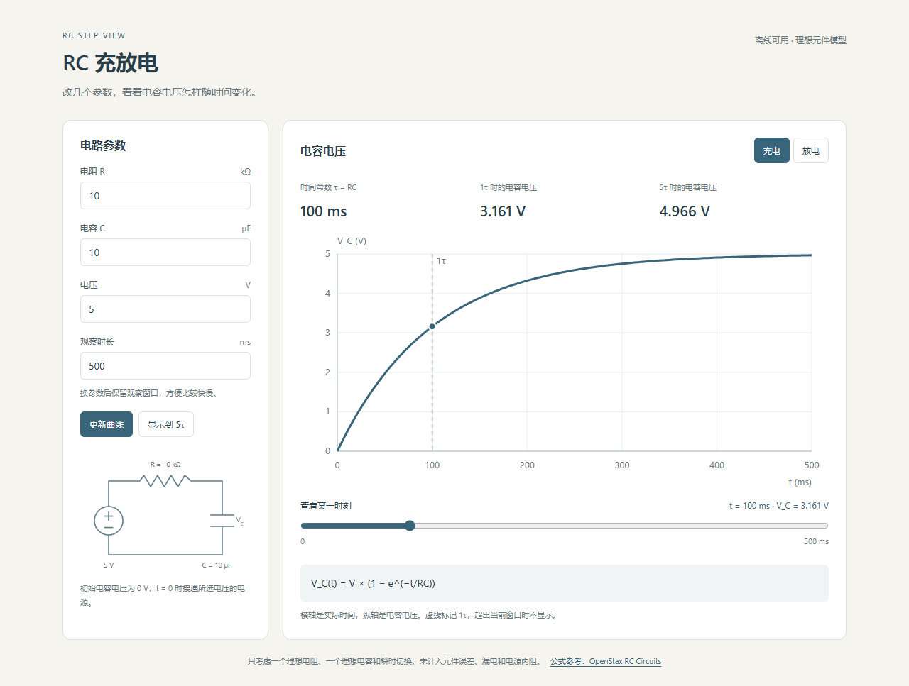

# RC Step View · RC 充放电

一个看理想 RC 充放电曲线的小页面。改电阻、电容和电压，观察时间常数与电容电压的变化。没有依赖，浏览器打开就能用。

A small page for exploring ideal RC charging and discharging. Change the resistance, capacitance and voltage to inspect the time constant and capacitor voltage. No dependencies are needed.



## 使用 / Use

下载仓库，用浏览器打开 `index.html`。参数会在输入有效数字后更新，也可以点击“更新曲线”。切换“充电 / 放电”，拖动下方滑块查看某一时刻的电压。

Download the repository and open `index.html` in a browser. Valid input updates the curve; you can also click “更新曲线”. Switch between charging and discharging, then move the slider to inspect a point in time.

电阻用 kΩ，电容用 µF，观察时长用 ms。默认 10 kΩ、10 µF、5 V，观察 500 ms。改变 R 或 C 后，时间窗口保持原值，方便在相同时间范围内比较。“显示到 5τ”会按当前参数调整窗口。

Resistance is in kΩ, capacitance in µF and the observation window in ms. Defaults are 10 kΩ, 10 µF, 5 V and 500 ms. Changing R or C keeps the time window fixed for comparison. “显示到 5τ” fits the window to five time constants.

也可以在仓库目录运行 `python -m http.server 8000`，再打开 `http://localhost:8000`。 / You can also run `python -m http.server 8000` in the repository and visit `http://localhost:8000`.

## 计算方式 / Model

时间常数 `τ = R × C`，计算前把单位换成 Ω 和 F。充电从 0 V 开始，接入所选电压 V 的理想电源；放电从所选电压 V 开始，电源断开，通过 R 放电。

The time constant is `τ = R × C`, after converting to Ω and F. Charging starts at 0 V with the selected ideal supply voltage V. Discharging starts at V with the supply removed and the capacitor connected through R.

```text
Charging:    V_C(t) = V × (1 − exp(−t / τ))
Discharging: V_C(t) = V × exp(−t / τ)
```

页面标出 1τ，并显示 1τ、5τ 的电压。公式依据 [OpenStax University Physics Volume 2, 10.5 RC Circuits](https://openstax.org/books/university-physics-volume-2/pages/10-5-rc-circuits)。曲线是公式计算结果，不是实验测量。

The page marks 1τ and reports the voltages at 1τ and 5τ. The equations follow [OpenStax University Physics Volume 2, 10.5 RC Circuits](https://openstax.org/books/university-physics-volume-2/pages/10-5-rc-circuits). Curves are calculated, not measured.

## 代码与检查 / Code and checks

`model.js` 做单位转换、参数校验和曲线采样；`app.js` 读取输入、画 SVG 图表和电路示意图。观察窗口远大于 τ 时，大部分采样点放在前 10τ，以免漏掉起点附近的快速变化。

`model.js` handles unit conversion, validation and curve sampling. `app.js` reads inputs and draws the SVG chart and circuit sketch. When the window is much longer than τ, most samples cover the first 10τ to retain the fast initial change.

装有 Node.js 时运行 `node --test`。检查包括已知参数的数值、固定时刻的 R/C 对比、曲线边界与单调性、长窗口采样和无效输入。 / With Node.js installed, run `node --test`. Checks cover known values, R/C changes at a fixed time, bounds and monotonicity, long-window sampling and invalid input.

一个小练习：保持默认 500 ms 窗口和滑块的 100 ms 时刻，把 R 从 10 改为 20 kΩ。先猜电压会升高还是降低，再检查 τ 和读数。想改代码，可以试着把默认 C 从 10 改为 22 µF，并让输入框与初始曲线保持一致。

A small exercise: keep the default 500 ms window and the slider at 100 ms, then change R from 10 to 20 kΩ. Predict whether the voltage increases or decreases, then check τ and the reading. For a code change, try setting the default C to 22 µF while keeping the input and initial curve consistent.

## 当前限制 / Limits

只处理一个理想电阻和一个理想电容的瞬时充放电。未计入元件误差、漏电、电容 ESR、电源内阻，也没有任意电路求解。两种模式分别从上述初始状态重新计算，不会接续上一条曲线。界面是中文，参数暂不保存，刷新后回到默认值。

The model covers one ideal resistor and one ideal capacitor with instantaneous switching. It omits tolerances, leakage, capacitor ESR and supply resistance; it is not a general circuit solver. Each mode uses its stated initial condition rather than continuing the previous curve. The interface is in Chinese. Parameters are not saved, and refreshing restores the defaults.

输入范围为 R、C 各 0.1–1000（kΩ、µF），V 为 0–24 V，窗口为 0.001–5000000 ms。范围用于限制页面输入，不能据此选择实际元件的额定值。 / Input ranges are 0.1–1000 for R and C (kΩ and µF), 0–24 V, and 0.001–5000000 ms. These are page input limits, not component rating guidance.
